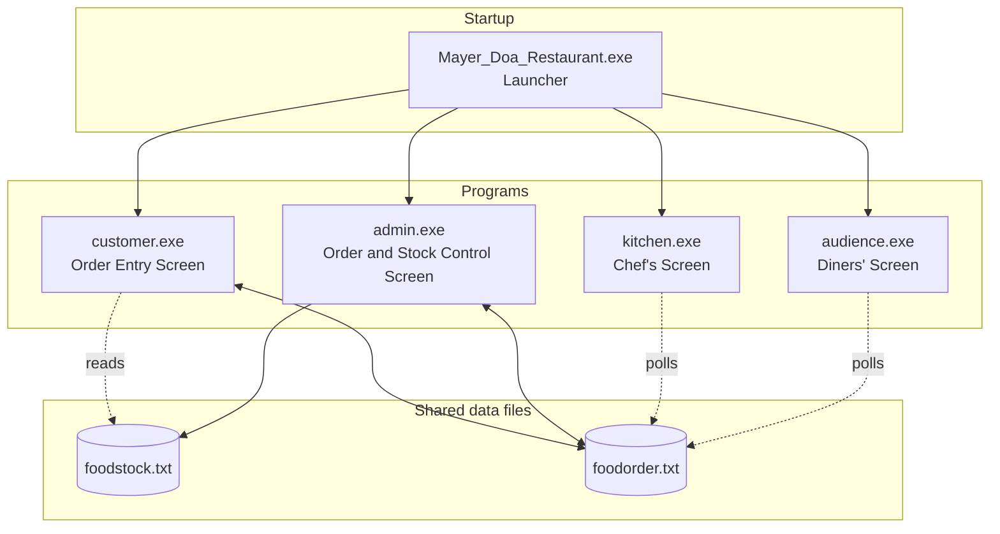

# Mayer Doa Restaurant

**A Multi-Terminal, Real-Time Food Order Management System built entirely in C.**

---

## About

Mayer Doa Restaurant is a terminal-based restaurant management system designed to simulate real restaurant operations across four simultaneously running console windows acting as screens. A single launcher boots the entire system - one window for customers placing orders, one for the admin managing the restaurant, one for the kitchen staff preparing food and one for diners waiting to pick up their meals. All four screens stay synchronized in real time through shared text file based data storage, with no database server or network stack required.

The primary goal was to experiment with real-time file handling, multi-process coordination and inter-program communication only using standard C libraries.

**AI Usage:** No AI tools were used to generate any part of the code. All code was written manually.


---

## Features

- **Multi-Screen Launch** - A single launcher program spawns four independent terminal windows simultaneously acting as different screens.
- **Dine-in and Takeaway Ordering** - Customers choose between reserving tables for dine-in or placing takeaway orders.
- **Table Reservation System** - Visual map of 10 tables showing real-time availability; customers can book one or multiple tables per order. Tables are highlighted according to their availability.
- **Dynamic Food Menu** - Menu reads from a stock file; unavailable items are hidden from customers automatically according to Admin input.
- **Cart and Receipt Generation** - Customers add items with quantities, get a calculated total in BDT and receive an order ID in a receipt.
- **Order lifecycle tracking** - Every order moves through three statuses: `1` (Placed) → `2` (Ready) → `3` (Delivered). The admin advances each step.
- **Chef's Live dashboard** - Auto-Refreshing screen (every 3 seconds) showing all orders at status `1` with OrderID, item breakdown and table numbers.
- **Diner's Pickup Board** - Auto-refreshing screen (every 3 seconds) showing all orders at status `2` with table numbers, notifying customers their food is ready.
- **Food Stock control** - Admin can toggle availability of any menu item on or off.
- **Sales Report** - Admin can pull total revenue filtered by specific month or day.
- **Session Management** - Admin can release all tables and reset active orders, with optional automatic restocking of all food items.
- **Persistent Order History** - All orders are appended to a log file with date, table, item quantities and pricing for audit and reporting.
- **ANSI Color-Coded UI** - Terminal output uses ANSI escape codes for a clean, color-differentiated visually appealing interface across all four screens.

---

## Tech Stack

| Layer | Technology |
|---|---|
| Language | C (C99) |
| Build | GCC (MinGW / any C compiler) |
| Platform | Windows (uses `system("cls")`, `system("start ...")`) |
| Storage | Text File based Data Storage (`foodorder.txt`, `foodstock.txt`) |
| IPC | File-based - all four processes read/write shared `.txt` files in Real-Time|
| UI | Windows Terminal with ANSI color coding |

---

## System Overview

The system operates as four independent processes that share state through two text files on disk. There is no client-server architecture and no sockets - synchronization happens because each process reads the latest file contents on every cycle or user action in Real-Time.

**Order lifecycle:**

```
Customer places order ──► foodorder.txt (status 1)
                                │
            Kitchen screen polls ──► shows orders at status 1
                                │
          Admin advances status ──► status 1 → 2
                                │
            Diner screen polls  ──► shows orders at status 2
                                │
          Admin advances status ──► status 2 → 3 (delivered, table released)
```

---

## System Architecture

The system is organized in three layers: a launcher, four single-purpose programs and two data files.



Solid arrows show a program writing to a file or starting another program. Dotted arrows show a program reading a file. Double-headed arrows mean the program both reads and writes that file.

| Screen | Role | File Access |
|---|---|---|
| **Customer** (`customer.exe`) | Places dine-in/takeaway orders, books tables | Reads both files, appends to `foodorder.txt` |
| **Admin** (`admin.exe`) | Advances order status, views sales, manages stock/sessions | Reads and rewrites both files |
| **Kitchen** (`kitchen.exe`) | Displays pending orders (status 1) on a 3-second refresh loop | Reads `foodorder.txt` |
| **Audience** (`audience.exe`) | Displays ready orders (status 2) on a 3-second refresh loop | Reads `foodorder.txt` |

---


## Directory Structure

```
Mayer_Doa_Restaurant/
├── Mayer_Doa_Restaurant.c   # Launcher - spawns all four screens
├── customer.c               # Customer-facing order and table booking terminal
├── admin.c                  # Admin panel for order/status/sales/stock management
├── kitchen.c                # Chef's auto-refreshing pending order display
├── audience.c               # Diner's auto-refreshing ready order display
├── foodorder.txt            # Order database (append-only log)
└── foodstock.txt            # Menu item availability flags
```

---

## Build and Run

**Prerequisites:** A C compiler (GCC via MinGW, or MSVC) on Windows.

**Compile all modules:**

```bash
gcc customer.c -o customer.exe
gcc admin.c -o admin.exe
gcc kitchen.c -o kitchen.exe
gcc audience.c -o audience.exe
gcc Mayer_Doa_Restaurant.c -o Mayer_Doa_Restaurant.exe
```

**Run:**

```bash
Mayer_Doa_Restaurant.exe
```

This launches all four terminal windows. The customer screen is interactive - start placing orders. Use the admin screen to manage the flow.

> **Note:** All `.exe` files and `.txt` data files must be in the same directory.

---

## Limitations

- **Windows only** - Relies on `system("cls")`, `system("start ...")`- and `sleep()` from `<unistd.h>` (MinGW). Not portable to Linux/macOS without modification.
- **No file locking** - Concurrent reads and writes to the shared text files can cause race conditions under heavy simultaneous use.
- **Fixed menu** - The five menu items and their prices are hardcoded in `customer.c`. Adding items requires code changes.
- **No authentication** - The admin panel has no login or access control.
- **Sequential order IDs** - Order IDs are tracked in memory by the customer process; restarting the customer screen reloads the last ID from file, but simultaneous customer instances would collide.
- **Fixed table count** - The system supports exactly 10 tables, hardcoded in arrays.

---

## Authors

Built by [**Zeba Anika**](https://github.com/zeba-anika) and [**Rajesh Karmaker**](https://github.com/rajeshkarmaker).

## License

This project is open source and available under the [MIT License](LICENSE).

